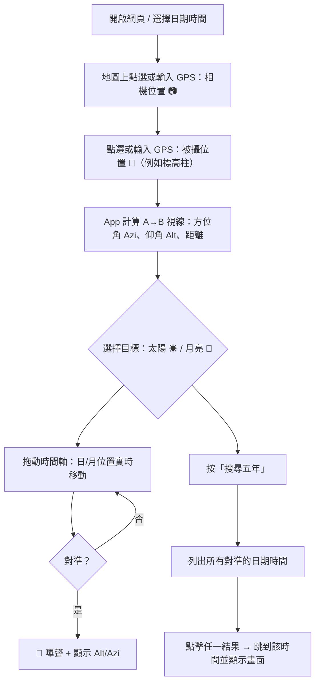
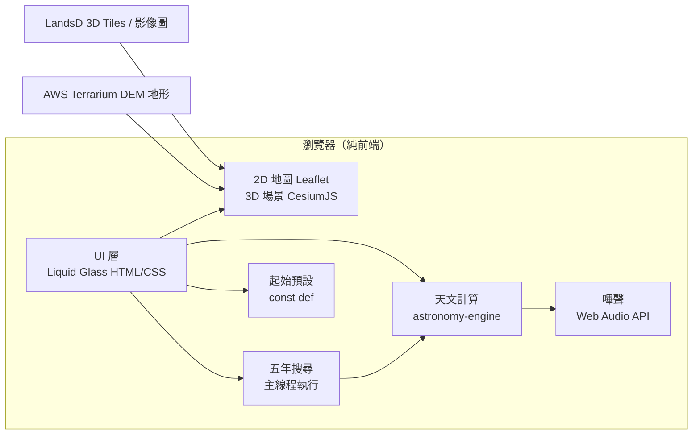

# 🌗 日月路線 Sun-Moon Trail（香港）

> 一個給攝影師用的**香港境內日／月拍攝規劃工具**，類似「巧攝 PlanIt Pro」，但專門用香港地政總署（LandsD）的 **3D 地圖數據**，準確計算太陽／月亮會在哪一天、哪一個時間，出現在山頭、建築物或標高柱後方。


- **網頁版**（電腦／手機瀏覽器都能用），最後才考慮做手機 App。
- **首次使用需要連網**（載入 Cesium、astronomy-engine CDN 及地圖數據）。
- UI 採用 **Liquid Glass（液態玻璃）** 風格。

---

## 目錄
1. [目的與使用情境](#1-目的與使用情境)
2. [功能清單](#2-功能清單)
3. [操作流程（使用例子）](#3-操作流程使用例子)
4. [系統架構](#4-系統架構)
5. [數據來源](#5-數據來源)
6. [天文計算方法](#6-天文計算方法)
7. [日／月真實大小的顯示](#7-日月真實大小的顯示)
8. [對準判定與嗶聲](#8-對準判定與嗶聲)
9. [五年同角度搜尋](#9-五年同角度搜尋)
10. [日食／月食追蹤](#10-日食月食追蹤)
11. [離線使用設計（規劃中）](#11-離線使用設計規劃中)
12. [UI 設計（Liquid Glass）](#12-ui-設計liquid-glass)
13. [資料夾結構](#13-資料夾結構)
14. [安裝與執行](#14-安裝與執行)
15. [API Key 與私隱](#15-api-key-與私隱)
16. [開發階段 Roadmap](#16-開發階段-roadmap)
17. [已知限制](#17-已知限制)
18. [參考資料](#18-參考資料)
- [附錄 A：3D 實景 VR 取景器](#附錄-a3d-實景-vr-取景器)
- [附錄 B：專案結構](#附錄-b專案結構)
- [附錄 C：Google Maps、LandsD 與 PlanIt 比較](#附錄-cgoogle-mapslandsd-與-planit-比較)
- [附錄 D：2025-09-17 18:03 驗證](#附錄-d2025-09-17-1803-驗證)
- [附錄 E：部署到 Linux 伺服器](#附錄-e部署到-linux-伺服器)

---

## 1. 目的與使用情境

在香港境內，設計／計劃拍攝：

| 情境 | 例子 |
|---|---|
| 日出／日落在山頂或標高柱後方 | 站在 A 點，拍太陽剛好落在大帽山標高柱後面 |
| 月出／月落在建築物後方 | 滿月剛好從 IFC 頂部升起 |
| 長焦「大月亮」構圖 | 月亮與遠處涼亭／燈柱重疊，月亮大小需真實 |
| 日偏食／月全食軌跡 | 計劃連拍整個月全食過程在某建築物上方的路線（✅ 已實作：日月串珠，見 §10.1） |

核心問題只有一個：**「相機在 A 點，被攝物在 B 點，日／月何時會在 A→B 這條直線上？」**

---

## 2. 功能清單

| # | 功能 | 說明 | 狀態 |
|---|---|---|---|
| 0 | **日／月一天的路徑** | 在地圖上畫出所選日期太陽、月亮的東升→西落方位線及全日軌跡（每 5 分鐘一點，可調），標示升起／中天／落下時間 | ✅ |
| 1 | **香港 3D 地圖** | 道路、建築、地形 3D 顯示（Cesium），可放大／縮小／旋轉 | ✅ |
| 1a | **輸入 GPS 坐標** | 可直接輸入 `22.4399, 114.0344` 設定相機或被攝點 | ✅ |
| 2 | **相機位置** | 點地圖設定（📷 圖示），可調整相機離地高度（預設 6 m AGL） | ✅ |
| 3 | **被攝位置** | 點地圖設定（🎯 圖示），可手動修改高度（mPD） | ✅ |
| 4 | **視線連接 + 對準嗶聲** | 相機→被攝點畫一條直線，計算該線的方位角（Azi）及仰角（Alt）。當日／月位置與此線對準時**發出嗶聲**，並顯示日／月的 Alt / Azi | ✅ |
| 5 | **五年同角度搜尋** | 搜尋所選日期起 5 年內所有日／月對準 A→B 線的日期時間（Azi/Alt 容差可設，預設各 ±1°） | ✅ |
| 6 | **日食／月食追蹤** | 左面板第 3 分頁，列出 5 年內在相機位置可見的日食、月食（種類、遮擋%、開始/結束、Azi/Alt）；點列跳到食甚並自動對準日／月 | ✅ 已實作 |
| 6a | **日月串珠** | 右方兩個視角沿全日軌跡每 120 秒畫一個真實大小的日／月面（珠與珠剛好不重疊）；非食日時是普通串珠，食日時逐粒按食分變形變色（日食黑月影咬日、月食半影→缺口→紅月），食甚嗰粒有白圈。左面板「日月串珠」勾選開關 | ✅ 已實作 |
| 7 | **相機視窗模擬 (Viewfinder)** | 輸入焦距（24–2000mm 全片幅），模擬相機看到的畫面，日月以真實角大小顯示 | ✅ |
| 8 | **起始場景** | 每次載入一律以程式內 `const def` 起始（日期／天體／相機／被攝點／時間），不讀取 localStorage 已儲存設定；修改只在本次瀏覽有效；全日路徑可匯出 CSV | ✅（JSON 匯出／匯入未實作） |

---

## 3. 操作流程（使用例子）

參考巧攝 PlanIt 的使用方法：



**例子：** 想拍滿月落在山上涼亭後方
1. 被攝點輸入涼亭坐標 `22.4447634, 114.0372229`
2. 相機點選在山腳 `22.4399544, 114.0348223`
3. 選「月亮」→「搜尋五年」
4. 結果例如：`2025-04-14 20:22  Azi 12.3°  Alt 4.1°`
5. 點擊結果 → 3D 畫面顯示月亮在涼亭後方

---

## 4. 系統架構

純前端網頁（無後端伺服器），所有計算在瀏覽器內完成。



| 部分 | 技術選擇 | 原因 |
|---|---|---|
| 2D 地圖 | **Leaflet** | 輕量，顯示相機／被攝點、日月路徑 |
| 3D 場景 | **CesiumJS** | 原生支援 3D Tiles（LandsD 數據格式）、地形、地球坐標、相機視角 |
| 天文計算 | **astronomy-engine@2.1.19**（JS，MIT，CDN 載入） | 準確度約 1 角分，內建月相、大氣折射 |
| 界面 | 原生 HTML + CSS + JavaScript | 簡單，不用 build 工具 |
| 搜尋 | 主線程執行（未用 Web Worker） | 五年搜尋在背景分批執行，不卡住畫面 |
| 儲存 | 不儲存——每次載入以 `const def` 起始 | 永遠回到同一重現場景，不會被上次狀態蓋過 |

> 原則：**簡單優先**。不用 React / Node build，以本地 http server 開啟 `index.html` 即可。

---

## 5. 數據來源

| 數據 | 來源 | 用途 |
|---|---|---|
| 香港 3D 樓宇／道路（3D Tiles） | LandsD 3D Spatial Data API（`building`、`infrastructure` tileset，需 API key） | 3D 場景中的建築物顯示 |
| 地形高度 DEM | AWS Terrain Tiles（Terrarium 格式，公開） | 3D 場景地形、計算地面標高 |
| 2D 底圖／影像圖 | LandsD 地圖 API（`mapapi.geodata.gov.hk` 影像圖 xyz） | Cesium 底圖影像 |
| 標高柱／燈柱坐標 | 使用者輸入 | 被攝點 |

坐標系統：內部統一使用 **WGS84（Lat, Long）**。

**高度分兩種，勿混淆：**
- **相機高度** = **AGL**（Above Ground Level，離地高度），例如行人天橋填 `6`（米）。程式內部會加上 DEM 地面標高，換算成 Cesium 用的絕對高度。
- **被攝點高度** = **mPD**（metres above Principal Datum，主水平基準以上米數），香港通用的絕對高度，例如填 `200`。

**mPD 是甚麼？** 即「主水平基準以上若干米」，單位是 **米**。主水平基準（PD）是香港高度的零點，約在平均海平面以下 1.2–1.3 米。香港地圖、建築圖則及地政總署高度資料均用 mPD，可直接填入。

---

## 6. 天文計算方法

使用 `astronomy-engine`，觀測者位置 = 相機 GPS + 高度。

| 計算 | 函數／方法 |
|---|---|
| 日／月方位角 Azi、仰角 Alt | `Equator()` → `Horizon()`（含大氣折射 `refraction: "normal"`） |
| 升起／落下／中天 | `SearchRiseSet()` |
| 月相、照亮比例 | `Illumination()` |
| 日／月距離（計算角大小） | `GeoVector()` 長度 |
| 月亮視差 | 使用 topocentric（地表觀測者）坐標 |

> 日食／月食函數（`SearchLocalSolarEclipse()`、`SearchLunarEclipse()`）為 astronomy-engine 內建，留待第 10 節功能實作時使用。

**視線（相機 → 被攝點）方位角與仰角：**

- 方位角 Azi：大圓方位公式，由北順時針 0–360°
- 仰角 Alt：`atan2(被攝點高 − 相機高, 水平距離)`，再扣地球曲率及大氣折射修正。左面板「視線」一欄會註明「已計地球曲率＋折射」。

時間全部以**香港時間 (UTC+8)** 顯示。

---

## 7. 日／月真實大小的顯示

需求：「日／月在版面放大／縮小需為其真實大小」。

- 角直徑：
  $$\theta = 2\arctan\left(\frac{R_{body}}{D}\right)$$
  - 太陽：約 0.524°–0.542°
  - 月亮：約 0.49°（遠地點）–0.56°（近地點，超級月亮）
- **3D 實景面板**：在 2D 覆蓋層（canvas overlay）上，於日／月方向按角直徑換算像素大小畫出圓盤（太陽橙色、月亮藍色），所以無論放大／縮小、旋轉，日／月與建築物的比例都是真實的。日／月**不是** Cesium 內的 billboard，而是與 3D 相機同一視錐的 2D 投影。
- **焦距換算**：`視角 = 2·atan(18 / f)`（全片幅 36mm 寬，半寬 18mm），例如 300mm → 水平視角約 6.87°。焦距選項：24 / 50 / 100 / 200 / **300** / 400 / 600 / 800 / 1200 / 2000 mm。
- 實作修正（2026-10-19）：Cesium 相機 pitch 為正向朝上（`pitch:rad(alt)`，−90° = 朝下）；2D 投影用正方形像素（`fx = fy`），舊碼曾用 `fx = fy·(W/H)` 導致水平拉伸，已修正。

---

## 8. 對準判定與嗶聲

1. 計算 A→B 視線的 `(Azi_line, Alt_line)`
2. 計算當時日／月的 `(Azi_body, Alt_body)`
3. 角距離：
   $$\Delta = \arccos\big(\sin a_1 \sin a_2 + \cos a_1 \cos a_2 \cos(z_1 - z_2)\big)$$
4. 當 $\Delta$ 小於主頁「對準容差」（預設 **1°**，可調）→ **🔔 嗶聲**（Web Audio API 產生短音，不用音檔）
5. 畫面同時顯示：
   - 日／月 Alt / Azi、角直徑、距離、月相 %
   - 與視線差 Δ（`ΔAzi / ΔAlt`）
6. **全日路徑表**：所選日期每 5 分鐘（可調）一列，列出日／月 Azi、Alt，可匯出 **CSV**（`trail_YYYY-MM-DD.csv`）

---

## 9. 五年同角度搜尋

左面板第 2 分頁「🔵 五年相同角度」。

| 設定 | 預設 |
|---|---|
| 目標 | 太陽 / 月亮（跟隨主頁選擇） |
| 範圍 | 所選日期起 5 年 |
| Azi 容差 | ±1.0°（可改） |
| Alt 容差 | ±1.0°（可改） |

**演算法：**
1. 以 **20 分鐘**步長掃描 5 年，計算每次日／月經過時與 📷→🎯 視線的角距離，找局部最小值
2. 在該時段內用黃金分割法收窄到約 **1 秒**精度
3. 保留 |ΔAzi| ≤ Azi 容差 且 |ΔAlt| ≤ Alt 容差 的結果
4. 在主線程分批執行，顯示進度；結果列表可排序、點擊跳轉（不會重新搜尋）

- 列表欄位：`日期 | 時間 | Azi | Alt | ΔAzi | ΔAlt`
- 無結果顯示「（沒有符合項目）」；超過 150 項只列首 150 項
- 顏色：**ΔAzi / ΔAlt 綠色** = 該差值 ≤ 主頁「對準容差」（預設 1°）；**兩者皆綠**時該列日期、時間、Azi、Alt 以**黃色**顯示，即日／月會正好落在被攝點上；**只有一項綠**時以**淺紫色**顯示
- 自動更新：拖動／點選 📷 相機或 🎯 被攝點、修改座標／高度、⇄ 交換、改天體、日期、Azi／Alt 容差或主頁「對準容差」→ 取消舊搜尋並重新搜尋（分頁未開啟時，於開啟時才搜尋）

---

## 10. 日食／月食追蹤

### 10.1 現行實作（左面板第 3 分頁「🌒 日食／月食」）✅

- 範圍：由所選日期起 5 年，在**相機位置**可見的日食、月食（astronomy-engine `SearchLocalSolarEclipse()` / `SearchLunarEclipse()`）
- 篩選：日食只列太陽在地平線以上且遮擋 > 0.1% 的；月食只列食甚時月亮在地平線以上的
- 列表欄位：`日期 | 食甚時間 | 類型（☀ 日食／🌙 月食）| 種類（偏食／全食／環食／半影月食）| 遮擋% | 開始 | 結束 | Azi | Alt`
- 點擊任一列：跳到食甚時刻，天體自動切換為太陽／月亮，**右側兩個面板自動對準**當時的日／月（等於按了 🎯 對準日/月；五年相同角度的列同樣會對準）；留在列表不跳頁
- 左面板各列表（五年相同角度、日食／月食、全日路徑）被點中的列會**保持橙色高亮**（左邊有橙色標記線），唔會跳完時間就唔記得點咗邊行；重新搜尋重建列表後會自動標返同一行
- 相機位置／日期改變時自動標記要重新搜尋
- 實測：香港未來 5 年約 8 次可見（日偏食 2 次、月食 6 次，含 2028-12-31 跨年夜月全食）
- **日月串珠（右方 VR 取景器＋廣角實景）**：左面板「日月串珠」勾選（預設開）後，兩個視角會沿全日日／月軌跡每 **120 秒**畫一個真實角大小的日／月面——日／月每 120 秒移動約 0.5°，剛好約一個直徑，所以串珠粒粒相接、不重疊
  - 非食日：普通串珠（太陽橙、月亮藍），用來預覽連拍／縮時入面日月點樣掃過畫面
  - 日食日：太陽串珠逐粒被**黑色月面**按當分鐘的真實相對位置咬住（初虧→食甚→復圓一目了然）；食甚嗰粒加白圈標記
  - 月食日：月亮串珠按食分逐粒變色——半影階段逐漸變暗、偏食階段出現缺口（示意畫法：同大細的影圓由月面前進方向滑入，覆蓋率按半徑時長 `sd_partial/sd_total` 及食甚遮擋插值）、全食階段變**紅月**；食甚嗰粒同樣有白圈
  - 串珠的食象判斷獨立於第 3 分頁列表（用當日日期即時搜尋），所以就算列表篩選跌咗的事件（例如食甚在地平線以下的半影月食），串珠仍會正確顯示地平線以上的食相
  - 串珠顏色 legend：🔵 藍＝正常 · 🌘 變暗＝半影 · ⚫ 黑缺口＝本影偏食（日食時黑圓＝月影剪影） · 🔴 紅銅＝月全食 · ◎ 白圈＝食甚嗰粒

### 10.2 未來規劃（尚未實作）

1. 顯示各接觸時間：初虧 P1/U1、食既 U2、食甚 Max、生光 U3、復圓 U4/P4，及每個時刻日／月的 Alt / Azi
2. 可配合功能 5：反過來搜尋「哪個相機位置能讓食甚剛好在某建築上方」（給定被攝點及時間，計算相機需要站在的方向線）

> 原規劃的「整個食相移動軌跡」及「食相視覺效果」（日食黑影、月食紅月）已由 **日月串珠** 實作，見 §10.1 及功能 6a。

---

## 11. 離線使用設計（規劃中）

> ⚠️ 本節為**規劃**，目前尚未實作 Service Worker、Cache API 或 IndexedDB。首次使用需連網載入 CDN（Cesium、astronomy-engine、Leaflet）及地圖數據。

| 項目 | 規劃方法 |
|---|---|
| 程式本身（HTML/JS/CSS、Cesium、astronomy-engine） | Service Worker 首次載入後快取（PWA） |
| 天文計算 | 完全本機計算，不需網絡（已實現） |
| 3D 地圖 Tiles | 瀏覽過的區域自動快取；另設「下載此區域供離線使用」按鈕 |
| 計劃／收藏點 | IndexedDB（目前用 localStorage 暫代） |

> Service Worker 需在 `http://localhost` 或 https 下運作，不能用 `file://` 打開。目前用 `start.bat`（`python -m http.server 8765`）啟動即可。

---

## 12. UI 設計（Liquid Glass）

- 全螢幕 Leaflet 2D 地圖作背景，所有控制面板為**半透明磨砂玻璃**（`backdrop-filter: blur()`、柔和高光邊框、圓角）
- 版面（由左至右）：
  - **左面板**：分頁「主頁」／「🔵 五年相同角度」。主頁含日期、天體選擇（☀ 太陽／🌙 月亮）、相機（緯度、經度、離地高度 m）、被攝點（緯度、經度、高度 mPD）、手動地標、視線（Azi／Alt／距離）、日月資訊（Azi／Alt、角直徑、距離、月相、與視線差 Δ）、升落時間、全日路徑表（CSV 匯出）
  - **中央**：Leaflet 2D 地圖，📷 相機、🎯 被攝點標記，日／月全日軌跡線
  - **右上**：「VR 取景器（3D 實景 + 日月路徑）」—— Cesium 3D 場景 ＋ 2D 覆蓋層（日月軌跡、整點時間、真實大小日月盤、紅十字被攝點標記）
  - **右下**：「相機廣角實景（人眼高度 → 日/月）」—— 同上，預設廣角
  - **底部**：時間軸（`◀` 倒播、`▶` 播放／暫停、可拖動滑桿 00:00–23:59、`−1m`／`+1m` 微調、目前時間顯示）
- 右上 VR 框標題列：3D 模式選擇（對準放大 3D 實景／2D 圖表／全天圖）、焦距下拉（24–2000mm）、**🎯 對準日/月**按鈕
- 兩個 3D 框均支援：滾輪縮放、拖曳平移（平移後資訊面板顯示 `（pan +x.x° / +y.y°）`）、右下框雙擊重設視角
- 時間軸鍵盤：`←`／`→` 每次 ±1 分鐘

> 規劃中（尚未實作）：手機版底部抽屜、深色模式／紅光夜視模式。

---

## 13. 資料夾結構

```
sun-moon-trail/
├── README.md               本文件
├── .gitignore
├── index.html              主頁（全部功能在單一檔案）
├── config.js               個人設定：window.HK3D_KEY（不上傳 git）
├── start.bat               本機啟動：python -m http.server 8765
```

`config.js` 範例（本機專用，勿提交）：
```js
window.HK3D_KEY = '你的 LandsD API key';
```

---

## 14. 安裝與執行

```powershell
# 1. 進入資料夾（例：E:\AI\codex\sun-moon-trail）
cd E:\AI\codex\sun-moon-trail

# 2. 設定 config.js，填入自己的 LandsD key
#    window.HK3D_KEY = 'YOUR_LANDSD_API_KEY';

# 3. 啟動本機伺服器
#    雙擊 start.bat，或：
python -m http.server 8765

# 4. 瀏覽器打開
#    http://localhost:8765/index.html
```

> 必須用 http（`http://localhost:8765`），**不能用 `file://`**—— Cesium Web Worker 及瀏覽器安全限制要求 HTTP。
> 手機在同一 Wi-Fi 測試：`http://<電腦IP>:8765`。

---

## 15. API Key 與私隱

- LandsD 3D Spatial Data API Key **只供作者本人使用，不可公開**。
- Key 放在 `config.js`，此檔已列入 `.gitignore`，不會上傳 GitHub。
- 不收集任何使用者數據；設定不寫入 localStorage，只在本次瀏覽期間有效。

---

## 16. 開發階段 Roadmap

| 階段 | 內容 | 狀態 |
|---|---|---|
| **P1** | 網頁骨架、Liquid Glass UI、Cesium 載入 LandsD 3D Tiles | ✅ 完成 |
| **P2** | 功能 0：日／月一天路徑、升落方位線、時間軸 | ✅ 完成 |
| **P3** | 功能 2–4：相機點、被攝點、視線、Alt/Azi、對準嗶聲 | ✅ 完成 |
| **P4** | 功能 7：日月真實大小、相機視窗模擬、VR 取景器 | ✅ 完成 |
| **P5** | 功能 5：五年搜尋 | ✅ 完成（主線程，未用 Web Worker） |
| **P6** | 功能 6：日食／月食追蹤 | ✅ 已實作（列表+自動對準；接觸時間/軌跡/視覺特效未做） |
| **P7** | 離線：Service Worker、區域下載 | ⚠️ 尚未實作 |
| **P8** | 手機 App（PWA 安裝，或日後以 Capacitor 包裝） | ⚠️ 尚未實作 |

**驗證用例子**(2025-09-17 18:03）：

| 被攝點[朗庭園（Lang Ting Garden）太陽場景] | 相機點[拍攝點為元朗大馬路行人天橋] | 已知時間(例子 Azi ±0.2°, Alt ±0.2°) |
|---|---|---|
| 22.4446011, 114.0173931 | 22.4445094, 114.0322226 | 2026-03-28 18:04 |
| 22.4446011, 114.0173931 | 22.4445094, 114.0322226 | 2026-09-15 17:54 |
| 22.4446011, 114.0173931 | 22.4445094, 114.0322226 | 2027-03-28 18:04 |
| 22.4446011, 114.0173931 | 22.4445094, 114.0322226 | 2027-09-15 17:54 |

App 的五年搜尋結果應包含上述日期時間。

---

## 17. 已知限制

- 3D 模型精度取決於 LandsD 數據（樹木、臨時建築、新建樓宇未必包括）
- **樓宇高度／形狀可能不準**：實測朗庭園（元朗青山公路屏山段 139 號）兩棟塔樓在 3D Spatial Data 中只顯示為矮簇樓塊，而非實拍的高塔。屬數據本身限制，可回報地政總署（3dmap@landsd.gov.hk）；app 內可用「📍 手動地標」疊加示意樓宇作構圖參考
- **相機附近的地形／樓宇數據可能扭曲**：相機在低高度（如天橋 6m AGL）時，可能卡在 3D 數據的樓或 DEM 突起裡面，畫面出現巨大模糊塊或深色斜帶。解法：勾選「隱藏地形」（關閉 DEM 地形層）或「隱藏 3D 樓宇」，或按「隱藏近物」（near-plane 裁剪 100m，只裁身邊近物，遠樓保留）
- **相機高度預設 6m AGL**：`index.html` 內 `def.cam` 預設離地高度 6m（行人天橋實測高度）。高度差會改變樓頂視角高度，導致日／月與樓宇相對位置錯誤；務必按實際拍攝高度填寫（AGL，不是 mPD）
- 大氣折射在地平附近變化大（±0.2° 以上），接近地平的預測只能作參考
- 3D Tiles 數據量大，載入較慢
- 月亮位置受視差影響，相機 GPS 必須準確（手機 GPS 誤差可能 5–10 m，近距離被攝物影響較大）

---

## 18. 參考資料

- 巧攝 PlanIt Pro 說明：<https://www.planitphoto.cn/pdfs/>
- 香港天文台天文資料：<https://www.hko.gov.hk/tc/gts/astronomy/>
- LandsD 3D 地圖數據：見 [第 5 節](#5-數據來源)
- CesiumJS：<https://cesium.com/platform/cesiumjs/>
- astronomy-engine：<https://github.com/cosinekitty/astronomy>
- AWS Terrain Tiles（Terrarium DEM）：<https://s3.amazonaws.com/elevation-tiles-prod/terrarium/>

---

*設計文件版本 v0.2 — 2026-10-19，已按實作校正；第 10、11 節及 P6–P8 為規劃中功能。*

---

## 附錄 A：3D 實景 VR 取景器（右上 / 右下面板）

- 參考巧攝 PlanIt「虛擬 VR 取景器」：以相機位置、眼高、焦距模擬真實鏡頭畫面，疊加日／月全日軌跡、整點時間、真實大小日月盤及被攝點標記。
- **紅十字** = 被攝點方向（相機視線對準的目標點）。**紅色虛線圓** = 對準容差範圍（主頁「對準容差」的值，預設 1°）；日／月圓盤落入圓內即判定對準（app 會嗶聲並顯示 🔔）。構圖時把 ☀／☾ 圓盤移到十字上即可。
- 右上：對準放大（焦距下拉 24–2000mm 全片幅，或滾輪縮放、拖曳平移）。右下：廣角實景（滾輪縮放、拖曳平移，雙擊重設視角）。
- 拖曳平移後，資訊面板的 `View Azi / Alt` 會即時顯示 pan 偏移（例如 `View Azi 270.384° · Alt 6.981°（pan +10.0° / +0.0°）`），一眼看出相機已轉離預設視線。兩個框各自獨立平移。
- **🎯 對準日/月**按鈕（右上 VR 框標題列）：一鍵把右側**兩個**面板（VR 取景器＋相機廣角實景）的視角中心同時對準所選的日／月，方便構圖。預設視角是對著被攝點（例如高度角 6.98°），但太陽可能在 4.5°，300mm 窄視角下會落在框外；按此鈕即置中。
- **隱藏 3D 樓宇**勾選框（左面板相機區）：隱藏所有 3D 樓宇圖層（`tileset.show=false`，地形不受影響）。相機在低高度（如天橋 6m）時可能卡在 3D 數據的樓裡面，畫面出現巨大模糊塊；勾選即得乾淨視角，建議搭配手動地標使用。
- **隱藏地形**勾選框（左面板相機區）：關閉 DEM 地形層（`globe.show=false`，3D 樓宇不受影響）。若深色斜帶／扭曲來自地形數據（AWS Terrarium DEM 在相機位置有突起），勾選即消失。
- **隱藏近物／顯示近物**按鈕（左面板相機區）：把相機 near-plane 設為 100m／0.1m，只裁掉身邊 100 米內的扭曲近物，遠樓保留。
- **📍 手動地標（3D 示意樓宇）**（左面板）：當 LandsD 樓宇數據不準時（如朗庭園塔樓未正確建模），可手動新增示意樓宇。輸入方位角（從相機看過去）、距離（m）、高度（m）、寬度（m）、名稱 → 在兩個 3D 視角顯示半透明橘色盒子。地標只在本次瀏覽期間有效（reload 後回到 `def`），可刪除。
- 樓宇／道路橋樑：地政總署 3D Spatial Data API（`building`、`infrastructure` tileset）。山形：AWS Terrain Tiles（Terrarium DEM）。地面影像：地政總署 imagery（`mapapi.geodata.gov.hk`）。
- API key 依地政總署測繪處 GIS Projects Section 條款使用，存放於本機 `config.js`（已列入 `.gitignore`，不會推上 GitHub）：
  `window.HK3D_KEY = '你的 key';`
- 3D 需要以 http 開啟（Cesium Web Worker 不支援 file://）：雙擊 `start.bat`，瀏覽器開 http://localhost:8765 。未能載入 Cesium 時自動退回 2D 圖表。

---

## 附錄 B：專案結構

```
sun-moon-trail/
├── README.md               本文件
├── .gitignore
├── index.html              主頁（全部功能在單一檔案）
├── config.js               個人設定：window.HK3D_KEY（不上傳 git）
├── start.bat               本機啟動：python -m http.server 8765
```

### 使用自己的 LandsD API key

`config.js` 會被瀏覽器載入，內含 LandsD 3D Spatial Data API key。每個使用者／部署都必須向地政總署測繪處 GIS Projects Section 申請自己的 key，並遵守 LandsD 使用條款。切勿使用或轉發倉庫擁有者的 key。

把本機 `config.js` 的值換成自己的 key：

```js
// 僅本機使用，切勿提交個人 key。
window.HK3D_KEY = 'YOUR_LANDSD_API_KEY';
```

瀏覽器可見的 key 可被訪客下載。如 LandsD 支援限制，請把 key 限制在所需的服務及允許的來源（HTTP referrer）；切勿把個人 key 提交到公開倉庫。

### 本機執行

雙擊 `start.bat`，或執行：

```powershell
python -m http.server 8765
```

然後開啟 http://localhost:8765/index.html。**不要用 `file://` 開啟 `index.html`**—— Cesium 及瀏覽器安全規則要求 HTTP。

部署時，把 `index.html` 及該部署專用的 `config.js` 以 HTTP/HTTPS 提供即可。`start.bat` 只是本機 Windows 輔助工具，Linux 伺服器不需要。

---

## 附錄 C：Google Maps、LandsD 與 PlanIt 比較

### 建議

Google Maps 並非自動比 LandsD 好。建議採用混合設計：

- 香港境內以 **LandsD 3D Spatial Data** 為主：本地權威數據源，已配合本專案的 WGS84 及 mPD 流程。
- 其他城市／國家可選 **Google Photorealistic 3D Tiles**（Google 3D 覆蓋好的地區）。
- **Google Street View** 可作驗證模式：街景實拍有時比簡化樓宇模型更有用。
- 天文及相機計算**獨立於地圖供應商**：換地圖不能改變日／月 Azi、Alt、升落時間或對準結果。

> 目前實作只用 LandsD，未接 Google（規劃中）。

### 為何 PlanIt 流程值得參考

PlanIt 不只是一張普通地圖，它把相機釘、被攝物釘、相機高度、被攝物高度、方位角、高度角、焦距、視角、地形／樓宇背景、VR 取景器模式、日月時間軸結合在一起。關鍵是**同一個相機幾何同時用於背景和天體覆蓋層**。

本專案的對等流程：

1. 設定相機 GPS 及相機高度（AGL）。
2. 設定被攝點 GPS 及高度（mPD），或在兩棟樓之間選一個目標點。
3. 設定相機朝向／俯仰及焦距，例如向西、300mm。
4. 用選定的數據源從該相機位置渲染 3D 場景。
5. 把日／月投影到同一個相機視錐，在畫面旁顯示數字 Azi／Alt。
6. 3D 模型不完整的地方，用街景或使用者實拍照片驗證樓宇排列。

### 實作順序建議

1. 保持現有天文引擎及相機／視錐投影為唯一真實來源。
2. 引入 `sceneProvider` 設定：`LandsD HK`、`Google Photorealistic 3D`、`Street View 驗證`模式。
3. 加入供應商狀態徽章：覆蓋範圍、載入狀態、來源、版權聲明。
4. 加入手動朝向／俯仰校準及照片疊加模式，應對 3D 模型不準的地點。
5. 只在 Google 能實質改善該地點時才用，否則保留 LandsD，避免不必要的 API 成本及授權問題。

---

## 附錄 D：2025-09-17 18:03 驗證（2026-10-19 更新）

實拍照片與截圖**不是**像素級對比，除非所有相機輸入完全相同。舊截圖含有瀏覽器殘留狀態（不同的相機位置／高度／目標，含約 60m 的相機高度）。天橋測試請用：

```text
相機 GPS：22.4445391, 114.0321797
相機高度：6 m AGL（不是 mPD）
視角朝向：西／270°
日期時間：2025-09-17 18:03 HKT
焦距：實際鏡頭設定，75–300 mm
```

相機高度欄是 AGL，程式內部會加 DEM 地面標高換算成 Cesium 用的絕對高度；被攝點高度則是絕對 mPD。兩者勿混淆——在天橋這種低高度，差幾米就會移動屋頂線及日／月交點，即使天文 Azi／Alt 數字正確。

**2026-10-19 除錯筆記：**
- 修正了兩個投影 bug：(1) Cesium 相機 pitch 符號—— Cesium pitch 正向朝上（−90° = 朝下），舊碼寫反了；(2) 2D 覆蓋層投影水平拉伸—— `fx` 必須等於 `fy`（正方形像素），舊碼用 `fx = fy·(W/H)`。
- 日／月覆蓋層與 3D 樓宇經**同一個** Cesium 相機、同一幀渲染，所以平移（純旋轉）時它們剛性一起動——不會因 pan 而相對滑動。
- VR 視角平移後會顯示 pan 偏移（例如 `View Azi 270.384°（pan +10.0° / +0.0°）`）；**🎯 對準日/月**按鈕把右側兩個面板的視角中心同時對準日／月（預設視角對著被攝點，長焦下太陽可能落在框外）。
- 日／月圓盤按真實角大小繪製（太陽約 0.53°）。參考照片的太陽約佔畫面寬度 10%，相當於約 400mm 全片幅等效。
- **LandsD 數據問題已確認**：朗庭園塔樓（相機約 269° 方向）在 3D Spatial Data 中未建模為高塔——用 **📍 手動地標**疊加示意塔樓作構圖。

右面板覆蓋層必須用與 Cesium 相同的相機視錐。特別是寬的可調面板，水平與垂直 FOV 不同；用畫布長邊同時算兩軸會造成日／月水平偏移。實作把攝影水平 FOV 換算成 Cesium 垂直 FOV，覆蓋層用 `fx`／`fy` 針孔比例。

舊版曾把設定儲存在 localStorage，殘留狀態會蓋過預設值（見下面「重現場景」）；現已改為每次載入一律以 `const def` 起始，reload 即回到預設場景，不用再手動清儲存。換更好的地圖供應商也修正不了錯誤的朝向或不同的拍攝位置。

### 重現場景（原附錄 F，併入本附錄——同一個案）

以下設定重現參考照片 `0917-1803.jpg` 的朗庭園（Lang Ting Garden）日落場景（太陽在兩座塔樓之間），拍攝點為元朗行人天橋，正是程式 `const def` 的內容：

- 日期時間：**2025/09/17 18:03 HKT**
- 所選天體：**太陽**
- 相機：`22.4445094, 114.0322226`，**6 m AGL**
- 被攝點：`22.4446011, 114.0173931`，約 **200 mPD**
- 右側兩個 3D 面板初始對準相機→被攝點視線；使用中可調整相機、被攝點、焦距及面板視角
- 日期輸入框及各列表的日期一律以 **yyyy/mm/dd** 顯示（程式內部仍用 ISO `yyyy-mm-dd` 儲存及運算）
- 更新靜態部署後，若瀏覽器快取仍顯示舊版，用強制重新整理（`Ctrl+F5`）

程式每次載入（含 Ctrl+F5）一律以 `const def` 起始，**不再讀取 localStorage 的已儲存設定**。舊版的已儲存狀態會蓋過 `def`——只改 `def`、舊瀏覽器仍顯示上次儲存的日期（例如 2030/06/01）——故儲存／還原已移除；相機、被攝點、手動地標、校正值的修改只在本次瀏覽期間有效，reload 即回到 `def` 場景。

---

## 附錄 E：部署到 Linux 伺服器

## 不用 `start.bat` 複製檔案

`start.bat` 只是本機開發輔助（在 8765 port 起 Python HTTP server），Linux 伺服器不需要。把 `index.html` 及 `config.js` 複製到網站根目錄即可。

## 注意：`config.js` 的 API key

`config.js` 會被瀏覽器載入，內容可被每個訪客下載。Apache 必須能讀取它，瀏覽器必須能下載它；此公開設定檔用 `0644` 權限。

因此 `config.js` 內的 key 必須視為公開。不要把瀏覽器可見的 key 用於特權 API。如 key 有做限制，請限制在所需的 API 及 HTTP referrer。真正的 secret key 應放在伺服器端 endpoint 後面，只留伺服器持有；不要放進 `index.html` 或 `config.js`。

預期權限：兩個檔案 `-rw-r--r--`，目錄 `drwxr-xr-x`。改靜態檔不用重啟 Apache。如出現 403，檢查上層目錄的執行權限及 Apache error log。

---


