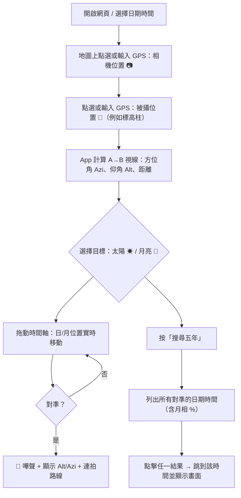
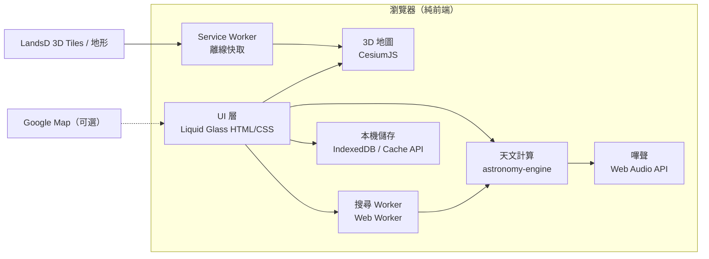

# 🌗 日月路線 Sun-Moon Trail（香港）

> 一個給攝影師用的**香港境內日／月拍攝規劃工具**，類似「巧攝 PlanIt Pro」，但專門用香港地政總署（LandsD）的 **3D 地圖數據**，準確計算太陽／月亮會在哪一天、哪一個時間，出現在山頭、建築物或標高柱後方。


- **先做網頁版**（電腦／手機瀏覽器都能用），最後才考慮做手機 App。
- **首次使用需要連網**，之後可以**離線使用**。只在需要時才用 Google Map。
- UI 採用 **Liquid Glass（液態玻璃）** 風格。

---

## 目錄
1. [目的與使用情境](#1-目的與使用情境)
2. [功能清單](#2-功能清單)
3. [操作流程（使用例子）](#3-操作流程使用例子)
4. [系統架構](#4-系統架構)
5. [數據來源](#5-數據來源)
6. [天文計算方法](#6-天文計算方法)
7. [日／月真實大小的顯示](#7-日月真實大小的顯示)
8. [對準判定與嗶聲](#8-對準判定與嗶聲)
9. [五年同角度搜尋](#9-五年同角度搜尋)
10. [日食／月食追蹤](#10-日食月食追蹤)
11. [離線使用設計](#11-離線使用設計)
12. [UI 設計（Liquid Glass）](#12-ui-設計liquid-glass)
13. [資料夾結構](#13-資料夾結構)
14. [安裝與執行](#14-安裝與執行)
15. [API Key 與私隱](#15-api-key-與私隱)
16. [開發階段 Roadmap](#16-開發階段-roadmap)
17. [已知限制](#17-已知限制)
18. [參考資料](#18-參考資料)

---

## 1. 目的與使用情境

在香港境內，設計／計劃拍攝：

| 情境 | 例子 |
|---|---|
| 日出／日落在山頂或標高柱後方 | 站在 A 點，拍太陽剛好落在大帽山標高柱後面 |
| 月出／月落在建築物後方 | 滿月剛好從 IFC 頂部升起 |
| 長焦「大月亮」構圖 | 月亮與遠處涼亭／燈柱重疊，月亮大小需真實 |
| 日偏食／月全食軌跡 | 計劃連拍整個月全食過程在某建築物上方的路線 |

核心問題只有一個：**「相機在 A 點，被攝物在 B 點，日／月何時會在 A→B 這條直線上？」**

---

## 2. 功能清單

| # | 功能 | 說明 |
|---|---|---|
| 0 | **日／月一天的路徑** | 在地圖上畫出所選日期太陽、月亮的東升→西落方位線及全日軌跡（每 10 分鐘一點），標示升起／中天／落下時間 |
| 1 | **香港 3D 地圖** | 道路、建築、地形 3D 顯示，可放大／縮小／旋轉。滑鼠位置即時顯示 GPS（Lat, Long）及標高 |
| 1a | **輸入 GPS 坐標** | 可直接輸入 `22.4399, 114.0344` 設定相機或被攝點（例如山上標高柱） |
| 2 | **相機位置** | 點地圖設定（📷 圖示），可調整相機離地高度（預設 1.6 m） |
| 3 | **被攝位置** | 點地圖設定（🎯 圖示），自動取得地面／建築頂部高度，可手動修改高度 |
| 4 | **視線連接 + 對準嗶聲** | 相機→被攝點畫一條直線，計算該線的方位角（Azi）及仰角（Alt）。當日／月位置與此線對準時**發出嗶聲**，並顯示日／月的 Alt / Azi，及連拍時的移動路線 |
| 5 | **五年同角度搜尋** | 搜尋未來（或過去）五年內所有日／月對準 A→B 線的日期時間（Azi 容差 ≤ 1°，Alt 容差可設定） |
| 6 | **日偏食／月全食追蹤** | 列出五年內在香港可見的日食、月食；顯示各階段（初虧、食既、食甚、生光、復圓）時間及位置，在畫面畫出整個食相過程路線 |
| 7 | **相機視窗模擬 (Viewfinder)** | 輸入焦距／感光元件尺寸，模擬相機看到的畫面，日月以真實角大小顯示 |
| 8 | **計劃儲存** | 每個計劃（相機點、被攝點、日期、備註）儲存在本機，可匯出／匯入 JSON |

---

## 3. 操作流程（使用例子）

參考巧攝 PlanIt 的使用方法：



**例子：** 想拍滿月落在山上涼亭後方
1. 被攝點輸入涼亭坐標 `22.4447634, 114.0372229`
2. 相機點選在山腳 `22.4399544, 114.0348223`
3. 選「月亮」→「搜尋五年」，勾選「只顯示月相 > 90%」
4. 結果例如：`2025-04-14 20:22  Azi 12.3°  Alt 4.1°  月相 99%`
5. 點擊結果 → 3D 畫面＋相機視窗顯示月亮真實大小在涼亭後方

---

## 4. 系統架構

純前端網頁（無後端伺服器），所有計算在瀏覽器內完成。



| 部分 | 技術選擇 | 原因 |
|---|---|---|
| 3D 地圖 | **CesiumJS** | 原生支援 3D Tiles（LandsD 數據格式）、地形、地球坐標、相機視角 |
| 天文計算 | **astronomy-engine**（JS，MIT） | 準確度約 1 角分，可離線，內建日食／月食、月相、大氣折射 |
| 界面 | 原生 HTML + CSS + JavaScript | 簡單，不用 build 工具 |
| 搜尋 | Web Worker | 五年搜尋不會卡住畫面 |
| 離線 | Service Worker + Cache API | 已看過的地圖區域、程式本身可離線 |

> 原則：**簡單優先**。不用 React / Node build，直接打開 `index.html`（經本地 http server）即可。

---

## 5. 數據來源

| 數據 | 來源 | 用途 |
|---|---|---|
| 香港 3D 地圖（方格型式 Tile-based） | [data.gov.hk – LandsD 3D Tile-based models](https://data.gov.hk/tc-data/dataset/hk-landsd-openmap-3d-visualisation-map-tile-based-models) | 大範圍 3D 地形＋建築顯示（主要使用） |
| 香港 3D 地圖（單體化模型 Individualised） | [data.gov.hk – LandsD 3D Individualised models](https://data.gov.hk/tc-data/dataset/hk-landsd-openmap-3d-visualisation-map-individualised-models) | 可點選單一建築物，取得其頂部高度作被攝點 |
| 地形高度 DTM | LandsD 地形數據（3D 數據附帶 / CSDI Portal） | 計算地面標高、視線是否被山擋住 |
| 2D 底圖 | LandsD 地圖 API（街道圖／影像圖） | 平面模式及離線底圖 |
| 標高柱／燈柱坐標 | 使用者輸入、[CSDI Portal](https://portal.csdi.gov.hk/) | 被攝點 |
| Google Map（可選） | Google Maps 連結 | 只作「在 Google Map 打開」連結，不嵌入，不需 API Key |

坐標系統：內部統一使用 **WGS84（Lat, Long, 橢球高）**；顯示時同時提供香港主水平基準（mPD）高度。如需要 HK1980 Grid 坐標輸入，會提供轉換。

**mPD 是甚麼？** = *metres above Principal Datum*，即「主水平基準以上若干米」，單位是 **米**。主水平基準（PD）是香港高度的零點，約在平均海平面以下 1.2–1.3 米；例如 60 mPD ≈ 海拔約 59 米。香港地圖、建築圖則及地政總署高度資料均用 mPD，可直接填入。
輸入高度 = 地面標高 + 離地高度（例如地面 58 mPD、相機離地 1.6 m → 填 59.6）。

---

## 6. 天文計算方法

使用 `astronomy-engine`，觀測者位置 = 相機 GPS + 高度。

| 計算 | 函數／方法 |
|---|---|
| 日／月方位角 Azi、仰角 Alt | `Equator()` → `Horizon()`（含大氣折射 `refraction: "normal"`） |
| 升起／落下／中天 | `SearchRiseSet()`、`SearchHourAngle()` |
| 月相、照亮比例 | `Illumination()`、`MoonPhase()` |
| 日／月距離（計算角大小） | `GeoVector()` 長度 |
| 月亮視差 | 使用 topocentric（地表觀測者）坐標，月亮差異可達約 1° |
| 日食／月食 | `SearchLocalSolarEclipse()`、`SearchLunarEclipse()` |

**視線（相機 → 被攝點）方位角與仰角：**

- 方位角 Azi：大地測量反算（Vincenty / 簡化 haversine 方位公式），由北順時針 0–360°
- 仰角 Alt：
  $$\text{Alt}_{line} = \arctan\left(\frac{h_B - h_A}{d}\right) - \frac{d}{2R}\ (\text{地球曲率修正})$$
  其中 $d$ 為水平距離，$R \approx 6371\text{ km}$。大氣折射已在日月位置計算中處理。

時間全部以**香港時間 (UTC+8)** 顯示。

---

## 7. 日／月真實大小的顯示

需求：「日／月在版面放大／縮小需為其真實大小」。

- 角直徑：
  $$\theta = 2\arctan\left(\frac{R_{body}}{D}\right)$$
  - 太陽：約 0.524°–0.542°
  - 月亮：約 0.49°（遠地點）–0.56°（近地點，超級月亮）
- **3D 地圖畫面**：在 Cesium 場景中，於日／月方向、某距離放置一個圓盤（billboard），其大小按角直徑換算，所以無論放大／縮小、旋轉，日／月與建築物的比例都是真實的。
- **相機視窗模擬**：
  $$\text{日月在畫面佔的像素} = \frac{\theta}{\text{FOV}} \times \text{畫面寬度}$$
  FOV 由焦距及感光元件尺寸計算（例如全片幅 600 mm → 水平 FOV ≈ 3.4°）。
- 月亮圓盤會顯示真實月相形狀及亮邊角度；日食時顯示月亮遮住太陽的真實比例。

---

## 8. 對準判定與嗶聲

1. 計算 A→B 視線的 `(Azi_line, Alt_line)`
2. 計算當時日／月的 `(Azi_body, Alt_body)`
3. 角距離：
   $$\Delta = \arccos\big(\sin a_1 \sin a_2 + \cos a_1 \cos a_2 \cos(z_1 - z_2)\big)$$
4. 當 $\Delta$ 小於容差（預設 = 日／月半徑，約 0.25°；可調）→ **🔔 嗶聲**（Web Audio API 產生短音，不用音檔）
5. 畫面同時顯示：
   - 日／月 Alt / Azi、距離、月相 %
   - **連拍路線**：對準時間前後 ±N 分鐘，每 X 秒一點（例如每 30 秒），在 3D 畫面及相機視窗畫出一串日／月圓盤，可匯出連拍時間表 (CSV)

---

## 9. 五年同角度搜尋

| 設定 | 預設 |
|---|---|
| 目標 | 太陽 / 月亮 |
| 範圍 | 今天起 5 年（可選過去 5 年） |
| Azi 容差 | ±1.0° |
| Alt 容差 | ±1.0°（可設定為「不限」，只看方位） |
| 篩選 | 月相範圍（例如 > 90% 滿月）、只限日出前後／日落前後、太陽在地平以下（夜拍月亮） |

**演算法（簡單、足夠快）：**
1. 以 **10 分鐘**步長掃描五年（約 26 萬點），計算日／月 Alt/Azi
2. 找出 Azi 跨過目標值的時段，且 Alt 在容差內
3. 在該時段內用二分法收窄到 **秒級** 最佳時間
4. 在 Web Worker 中執行，顯示進度條；結果列表可排序、點擊跳轉、匯出 CSV

輸出欄位：`日期時間 | Azi | Alt | 角距離 Δ | 月相 % | 日/月角直徑 | 太陽高度（天色）`

### 9.1 現行實作（左面板第 2 分頁「五年相同角度」）

- 範圍：由所選日期起 5 年；天體 = 主頁所選 ☀/🌙
- 條件：每次日/月經過時最接近 📷→🎯 視線的時刻（20 分鐘掃描角距離局部最小值 + 黃金分割法收窄至約 1 秒），且 |ΔAzi| ≤ **Azi 容差**（預設 ±1°，可改）及 |ΔAlt| ≤ **Alt 容差**（預設 ±2°，可改）
- 自動更新：地圖上拖動／點選 📷 相機或 🎯 被攝點、修改座標/高度、⇄ 交換、改天體、日期、Azi/Alt 容差或主頁「對準容差」→ 取消舊搜尋並重新搜尋（分頁未開啟時，於開啟時才搜尋）
- 列表欄位：`日期 | 時間 | Azi | Alt | ΔAzi | ΔAlt`；按列跳至該日期時間（不會重新搜尋）
- 無結果顯示「（沒有符合項目）」；超過 150 項只列首 150 項，最後一列顯示「… 另有 N 項」
- 顏色：**ΔAzi / ΔAlt 綠色** = 該差值 ≤ 主頁「對準容差」（預設 1°；日/月半徑約 0.25°）；**兩者皆綠** 時該列 **日期、時間、Azi、Alt 以黃色** 顯示，即日/月會正好落在被攝點上；**只有一項綠** 時該四欄以 **淺紫色** 顯示

---

## 10. 日食／月食追蹤

1. 列出未來五年香港可見的日偏食／日環食、月偏食／月全食
2. 選擇其中一次 → 自動把時間設為該次食相，顯示：
   - 各接觸時間：初虧 P1/U1、食既 U2、食甚 Max、生光 U3、復圓 U4/P4
   - 每個時刻日／月的 Alt / Azi
3. 在 3D 畫面與相機視窗畫出**整個食相的移動軌跡**（每 N 分鐘一個圓盤，顯示被遮比例），方便規劃多重曝光或連拍構圖
4. 可配合功能 5：反過來搜尋「哪個相機位置能讓食甚剛好在某建築上方」（給定被攝點及時間，計算相機需要站在的方向線）

---

## 11. 離線使用設計

需求：「首次使用連網，之後最好可以斷網使用」。

| 項目 | 方法 |
|---|---|
| 程式本身（HTML/JS/CSS、Cesium、astronomy-engine） | Service Worker 首次載入後快取（PWA） |
| 天文計算 | 完全本機計算，不需網絡 |
| 3D 地圖 Tiles | 瀏覽過的區域自動快取；另設「下載此區域供離線使用」按鈕（選範圍＋縮放層級，顯示預計大小） |
| 計劃／收藏點 | IndexedDB |
| Google Map | 只在有網絡時提供連結 |

> ⚠️ Service Worker 需在 `http://localhost` 或 https 下運作，不能用 `file://` 打開。用本機 `python -m http.server` 即可，**不需要設定 https**。

---

## 12. UI 設計（Liquid Glass）

- 全螢幕 3D 地圖作背景，所有控制面板為**半透明磨砂玻璃**（`backdrop-filter: blur()`、柔和高光邊框、圓角）
- 版面：

```
┌──────────────────────────────────────────────┐
│ [🔍 輸入 GPS / 地名]        [☀/🌙] [📅 日期]   │  ← 頂部玻璃列
│                                              │
│              3D 香港地圖                       │
│      📷 ─────────────────── 🎯  ☀             │
│                                              │
│ ┌─資訊面板─────┐              ┌─相機視窗──┐    │
│ │Azi 285.3°   │              │   ◐        │    │
│ │Alt  2.1°    │              │  ▲▲建築    │    │
│ │距離 3.42 km │              └───────────┘    │
│ │月相 98%     │                              │
│ └─────────────┘                              │
│ [◀ ━━━━━━━●━━━━━━━━ ▶]  18:42  [🔍搜尋五年]     │  ← 時間軸
└──────────────────────────────────────────────┘
```

- 時間軸可拖動（分鐘級），配合 `Shift`／`Ctrl` 切換日、月、年
- 底部時間列：`◀` 倒播、`▶` 順播（再按一次暫停）；`−1m`／`+1m` 微調；鍵盤 `←`／`→` 每次 ±1 分鐘（`Shift` = ±10 分鐘）
- 手機版：面板改為底部抽屜 (bottom sheet)
- 左側資訊面板預設佔滿視窗高度，可拖動邊緣調整大小；下方「全日路徑」表格會自動伸展填滿剩餘空間（最少 240px），面板越高顯示越多行
- 支援深色模式（夜拍時使用，並有「紅光模式」保護夜視）

---

## 13. 資料夾結構

```
sun-moon-trail/
├── README.md               本文件
├── .gitignore
├── index.html              主頁
├── config.js               個人設定（不上傳 git）
├── start.bat               startup 文件

```

---

## 14. 安裝與執行

```powershell
# 1. 進入資料夾
cd Z:\antigravity\sun-moon-trail

# 2. 複製設定範本，填入自己的 key（如需要）
copy config.example.js config.local.js

# 3. 啟動本機伺服器（使用專案 venv 的 Python）
Z:\antigravity\venv\Scripts\python.exe -m http.server 8765

# 4. 瀏覽器打開
#    http://localhost:8765
```

手機在同一 Wi-Fi 測試：`http://<電腦IP>:8765`（注意：非 localhost 的 http 無法使用離線功能，正式手機版會再處理）。

---

## 15. API Key 與私隱

- 所有 API Key **只供作者本人使用，不可公開**。
- Key 放在 `config.local.js`，此檔已列入 `.gitignore`，不會上傳 GitHub。
- 若某些 LandsD 服務需要 key，只在本機設定中填寫。
- 不收集任何使用者數據；所有計劃儲存在本機瀏覽器。

---

## 16. 開發階段 Roadmap

| 階段 | 內容 | 完成標準 |
|---|---|---|
| **P1** | 網頁骨架、Liquid Glass UI、Cesium 載入 LandsD 3D Tiles、顯示滑鼠 GPS／標高、GPS 輸入 | 可看到香港 3D 建築及地形 |
| **P2** | 功能 0：日／月一天路徑、升落方位線、時間軸 | 與 PlanIt / timeanddate 對比誤差 < 0.1° |
| **P3** | 功能 2–4：相機點、被攝點、視線、Alt/Azi、對準嗶聲、連拍路線 | 用 MC 文件中已知成功例子驗證 |
| **P4** | 功能 7：日月真實大小、相機視窗模擬 | 600 mm 下月亮大小正確 |
| **P5** | 功能 5：五年搜尋（Web Worker） | 五年搜尋 < 10 秒 |
| **P6** | 功能 6：日食／月食追蹤 | 與 HKO 天文台公佈時間一致 |
| **P7** | 離線：Service Worker、區域下載、計劃儲存 | 斷網後仍可開啟並計算 |
| **P8** | 手機 App（PWA 安裝，或日後以 Capacitor 包裝） | 手機可安裝並離線使用 |

**驗證用例子**（取自 `MC Planit Google Document.docx`）：

| 被攝點 | 相機點 | 已知時間 |
|---|---|---|
| 22.4399996, 114.034482 | 22.439969, 114.034483 | 2026-03-31 17:29 |
| 22.4400632, 114.034848 | 22.440090, 114.034772 | 2025-10-06 17:50 |
| 22.440306, 114.035037 | 22.440244, 114.035095 | 2025-03-14 18:59 |
| 22.4447634, 114.0372229 | — | 2025-04-14 20:22 |

App 的五年搜尋結果應包含上述日期時間。

---

## 17. 已知限制

- 3D 模型精度取決於 LandsD 數據（樹木、臨時建築、新建樓宇未必包括）
- **樓宇高度/形狀可能不準**：實測朗庭園（元朗青山公路屏山段139號）兩棟塔樓在 3D Spatial Data 中只顯示為矮簇樓塊，而非實拍的高塔。屬數據本身限制，已知案例可回報地政總署（3dmap@landsd.gov.hk）；app 內可用「📍 手動地標」疊加示意樓宇作構圖參考
- **相機附近的地形/樓宇數據可能扭曲**：相機在低高度（如天橋 6m AGL）時，可能卡在 3D 數據的樓或 DEM 突起裡面，畫面出現巨大模糊塊或深色斜帶。解法：勾選「隱藏地形」或「隱藏 3D 樓宇」，或按「隱藏近物」（near-plane 裁剪 100m）
- **相機高度預設 60m**：`index.html` 內 `def.cam` 預設離地高度 60m，行人天橋實測約 6m。高度差會改變樓頂視角高度（約 2°），導致日/月與樓宇相對位置錯誤；務必按實際填寫（AGL，不是 mPD）
- 大氣折射在地平附近變化大（±0.2° 以上），接近地平的預測只能作參考
- 3D Tiles 數據量大，離線下載建議只選需要的區域
- 月亮位置受視差影響，相機 GPS 必須準確（手機 GPS 誤差可能 5–10 m，近距離被攝物影響較大）

---

## 18. 參考資料

- 巧攝 PlanIt Pro 說明：<https://www.planitphoto.cn/pdfs/>
  - 03 日期時間日曆事件、04 取景器、05 日月
- 本資料夾：`planit pro.docx`、`TE Planit_06Mar25.doc`、`MC Planit Google Document .docx`
- 香港 3D 交通地圖教學：<https://www.pcmarket.com.hk/hk-realtime-3d-traffic-map-tutorial/>
- LandsD 3D 地圖數據：見 [第 5 節](#5-數據來源)
- CesiumJS：<https://cesium.com/platform/cesiumjs/>
- astronomy-engine：<https://github.com/cosinekitty/astronomy>
- 香港天文台 天文資料：<https://www.hko.gov.hk/tc/gts/astronomy/>

---

*設計文件版本 v0.1 — 2026-10-07，尚未開始編寫程式。*

## 3D 實景 VR 取景器（右上 / 右下面板）

- 參考巧攝 PlanIt「虛擬 VR 取景器」：以相機位置、眼高、焦距模擬真實鏡頭畫面，疊加日/月全日軌跡、整點時間、真實大小日月盤及 🎯 被攝點十字。
- **紅十字** = 被攝點方向（相機視線對準的目標點）。**紅色虛線圓** = 對準容差範圍（左面板「對準容差」的值，預設 1°）；日/月圓盤落入圓內即判定對準（app 會嗶聲並顯示 🔔）。構圖時把 ☀/☾ 圓盤移到十字上即可。
- 右上：對準放大（可選焦距 24–2000mm 全片幅，或滾輪縮放、拖曳平移）。右下：廣角（預設 80°，滾輪/拖曳，雙擊重設）。
- 拖曳平移後，資訊面板的 `View Azi / Alt` 會顯示 pan 偏移（例如 `View Azi 270.384° · Alt 6.981°（pan +10.0° / +0.0°）`），一眼看出相機已轉離預設視線。
- **🎯 對準日/月**按鈕（右上 VR 框標題列）：一鍵把 VR 視角中心對準所選的日／月，方便構圖。預設視角是對著被攝點（例如高度角 6.98°），但太陽可能在 4.5°，300mm 窄視角下會落在框外；按此鈕即置中。
- **隱藏 3D 樓宇**勾選框（左面板相機區）：隱藏所有 3D 樓宇圖層（`tileset.show=false`，地形不受影響）。相機在低高度（如天橋 6m）時可能卡在 3D 數據的樓裡面，畫面出現巨大模糊塊；勾選即得乾淨視角，建議搭配手動地標使用。
- **📍 手動地標（3D 示意樓宇）**（左面板）：當 LandsD 樓宇數據不準時（如朗庭園塔樓未正確建模），可手動新增示意樓宇。輸入方位角（從相機看過去）、距離（m）、高度（m）、寬度（m）、名稱 → 在兩個 3D 視角顯示半透明橘色盒子。地標儲存在本機（localStorage），可刪除。
- 樓宇 / 道路橋樑：地政總署 3D Spatial Data API（`building`、`infrastructure` tileset）。山形：AWS Terrain Tiles DEM。地面影像：地政總署 imagery。
- API key 依地政總署測繪處 GIS Projects Section 條款使用，存放於本機 `config.js`（已列入 `.gitignore`，不會推上 GitHub）：
  `window.HK3D_KEY = '你的 key';`
- The api key is used according to terms and conditions by GIS Projects Section, Survey and Mapping Office, Lands Dept 
- 3D 需要以 http 開啟（Cesium web worker 不支援 file://）：雙擊 `start.bat`，瀏覽器開 http://localhost:8765 。離線或未能載入 Cesium 時自動退回 2D 圖表。

## Current project structure and setup

The application is organized as follows:

```text
sun-moon-trail/
├── README.md               This document
├── .gitignore
├── index.html              Main page
├── config.js               Personal configuration (not committed to Git)
├── start.bat               BAT for startup

```

The root `config.js` used by the current browser entry point is the deployment-specific configuration file. The structure above describes the complete project layout, including the PWA, modular source files, local libraries, and documentation.

### Use your own LandsD API key

`config.js` is loaded in the browser and contains the LandsD 3D Spatial Data API key. Every user or deployment must obtain and use their own key from the Lands Department GIS Projects Section / Survey and Mapping Office, subject to LandsD terms and conditions. Do not use or redistribute the repository owner's key.

Replace the value in your local `config.js` with your own key:

```js
// Local only. Do not commit a personal key.
window.HK3D_KEY = 'YOUR_LANDSD_API_KEY';
```

Browser-visible keys can be downloaded by visitors. Restrict the key to the required service and allowed origins where LandsD supports restrictions, and never commit a personal key to a public repository.

### Run locally

From this directory, double-click `start.bat`, or run:

```powershell
python -m http.server 8765
```

Then open `http://localhost:8765/index.html`. Do not open `index.html` with `file://`; Cesium and browser security rules require HTTP.

For deployment, serve `index.html` and that deployment's own `config.js` over HTTP/HTTPS. `start.bat` is only a local Windows helper and is not required on Linux.

## Google Maps, LandsD and PlanIt comparison

### Recommendation

Google Maps is not automatically better for this application. The recommended design is a hybrid:

- Keep LandsD 3D Spatial Data as the primary provider for Hong Kong. It is the local authoritative source and already matches the WGS84 and mPD workflow used by this project.
- Add Google Photorealistic 3D Tiles as an optional provider for other cities and countries where Google has good 3D coverage.
- Add Google Street View as a verification mode when a real street-level view is more useful than a simplified building model.
- Keep the astronomy and camera calculations independent of the map provider. Changing the map must not change Sun/Moon Azi, Alt, rise/set time, or alignment results.

### 2025-09-17 18:03 verification and right-panel alignment (updated 2026-10-19)

The supplied photograph is not a valid pixel-for-pixel comparison with the
captured screenshots until all camera inputs are the same. The screenshots
contain a persisted browser state with a different camera position/height and
target, including a camera height around 60 m. For the footbridge test use:

```text
camera GPS: 22.4445391, 114.0321797
camera height: 6 m AGL (not mPD)
view heading: west / 270°
date and time: 2025-09-17 18:03 HKT
focal length: the actual lens setting, 75–300 mm
```

The camera height field is AGL. The DEM is added internally to obtain the
Cesium mPD camera elevation. The target height remains an absolute mPD value.
This distinction matters at a footbridge and can move the apparent roofline
and the Sun/Moon intersection even when the astronomical Azi/Alt values are
correct.

**2026-10-19 debugging notes:**
- Two projection bugs were fixed: (1) Cesium camera pitch sign — Cesium pitch is positive-up (-90° = looking down), the old code had it backwards; (2) horizontal stretch in the 2D overlay projector — `fx` must equal `fy` (square pixels), the old code used `fx=fy*(W/H)`.
- The Sun/Moon overlay and the 3D buildings are rendered through the **same** Cesium camera in the same frame, so panning (pure rotation) moves them rigidly together — they cannot slide relative to each other from pan alone.
- The VR view now shows a pan offset (e.g. `View Azi 270.384°（pan +10.0° / +0.0°）`) when panned, and a **🎯 對準日/月** button centers the view on the Sun/Moon (the default view aims at the target point, which may be several degrees above the Sun at long focal lengths).
- The Sun/Moon discs are drawn at true angular size (Sun ≈ 0.53°). The reference photo's Sun is ~10% of frame width, corresponding to ~400mm full-frame equivalent.
- **LandsD data issue confirmed**: the 朗庭園 towers (≈269° from camera) are not modeled as tall towers in 3D Spatial Data — use **📍 手動地標** to overlay schematic towers for composition.

The right-panel overlay must use the same camera frustum as Cesium. In
particular, a wide resizable panel has a different horizontal and vertical
FOV; using the canvas long side for both axes produces a horizontal Sun/Moon
shift. The implementation converts the photographic horizontal FOV to
Cesium's vertical FOV and uses separate `fx`/`fy` pinhole scales for the
overlay.

To discard an older test state in Chrome DevTools, run
`localStorage.removeItem('smt')`, reload, and enter the values above. A better
building provider cannot correct a stale saved camera state, a wrong heading,
or a different photograph viewpoint.

### What the PlanIt references show

The PlanIt workflow is more than a normal map. It combines a camera pin, scene/subject pin, camera height, subject height, azimuth, altitude, focal length, field of view, terrain or building background, a VR/viewfinder mode, and a time slider for the Sun and Moon. The important feature is the same camera geometry being used for both the background and the celestial overlay.

For this project, the equivalent workflow is:

1. Set the camera GPS and camera height.
2. Set the subject GPS and subject height, or select a target point between the two buildings.
3. Set the camera heading/tilt and focal length, for example west and 300 mm.
4. Render the selected provider's 3D scene from that exact camera.
5. Project the Sun/Moon into the same camera frustum and show the numerical Azi/Alt beside the view.
6. Use Street View or a user photograph to validate the building arrangement when the 3D model is incomplete.

### Why Google can help with other locations

Google Photorealistic 3D Tiles provide textured 3D city geometry and can be rendered by a compatible 3D Tiles renderer. This can look closer to a real photograph than block-style building data, especially outside Hong Kong. Coverage is not universal, so the application must detect missing coverage and fall back to terrain/building data rather than assuming that every location is available.

Google's Map Tiles API requires a Google Cloud project, API key or OAuth configuration, billing, session handling where applicable, and visible Google/data attribution. It is therefore a paid and licensed optional provider, not a drop-in replacement for the current public basemap. API keys must be restricted and must not be committed to the repository.

### Why Google will not automatically fix the current 朗庭園 comparison

A better map provider cannot correct a wrong camera height, heading, target point, target height, focal length, or timestamp. It also cannot make an old or differently located photograph match a 3D scene. For the current test, compare the same date and time (`2025-09-17 18:03`), camera height (`10 m`), westward heading, target GPS, and `300 mm` focal length. The Sun/Moon numbers should be validated separately from the building silhouette.

### Proposed implementation order

1. Keep the current astronomy engine and camera/frustum projection as the single source of truth.
2. Introduce a `sceneProvider` setting with `LandsD HK`, `Google Photorealistic 3D`, and `Street View verification` modes.
3. Add a provider status badge showing coverage, loading state, source, and attribution.
4. Add a manual heading/tilt calibration control and a photo overlay mode for locations where the 3D model is not sufficiently accurate.
5. Use Google only when it materially improves the selected location; otherwise keep LandsD to avoid unnecessary API cost and licensing complexity.

# Deploying the static site to the Linux server

## Copy the files without `start.bat`

`start.bat` is only a local development helper. It starts Python's local HTTP server on port 8765; it is not needed on the Linux server. Copy `index.html` and `config.js` to the your linux server root directory.

## Important: API key in `config.js`

`config.js` is loaded by the browser, so its contents are downloadable by every visitor. Apache must be able to read it, and a browser must be able to download it. Use `0644` for this public configuration file.

The key currently in `config.js` must therefore be treated as public. Do not use a browser-exposed key for privileged APIs. If the key has restrictions, restrict it to the required API, HTTP referrers. For a truly secret key, put API access behind a server-side endpoint and keep the secret only on the server; do not put it in `index.html` or `config.js`.

Expected permissions are `-rw-r--r--` for both files and `drwxr-xr-x` for the directory. No Apache restart is required for these static-file changes. If the site returns 403, check the parent-directory execute permissions and the Apache error log.
## Current default reproduction scene

The default view is configured to reproduce the requested Lang Ting Garden
(朗庭園) moon scene from the pedestrian footbridge on Yuen Long Main Street:

- Date and time: **2026/10/24 03:54 HKT**
- Selected body: **Moon**
- Camera: `22.4445094, 114.0322226`, **60 m AGL**
- Target: `22.4446011, 114.0173931`, approximately **200 mPD**
- The right-side 3D panels start centered on the camera-to-target view; the
  camera, target, focal length, and panel view can be adjusted during use.
- The upper-right and lower-right scene panels use a blue moon trail and blue
  moon marker; the Sun remains orange.
- The left information panel uses enlarged blue `🔵` moon icons for the Moon
  selector, current Moon values, rise/set rows, and trail/search headings.
- After updating a static deployment, use a hard refresh (`Ctrl+F5`) if an old
  browser cache still shows the previous yellow moon icons.

The reproduction scene uses a versioned browser settings key, so settings from
an earlier version do not hide this new default on first load. Changes made
after loading are saved for subsequent visits.
